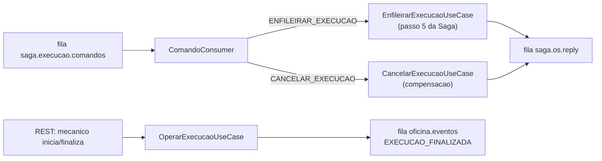
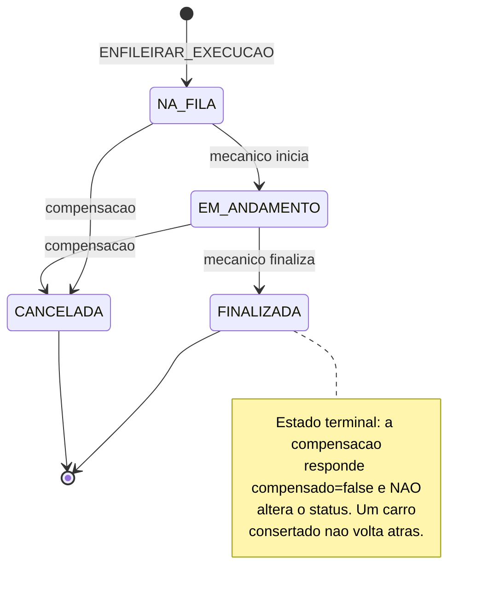
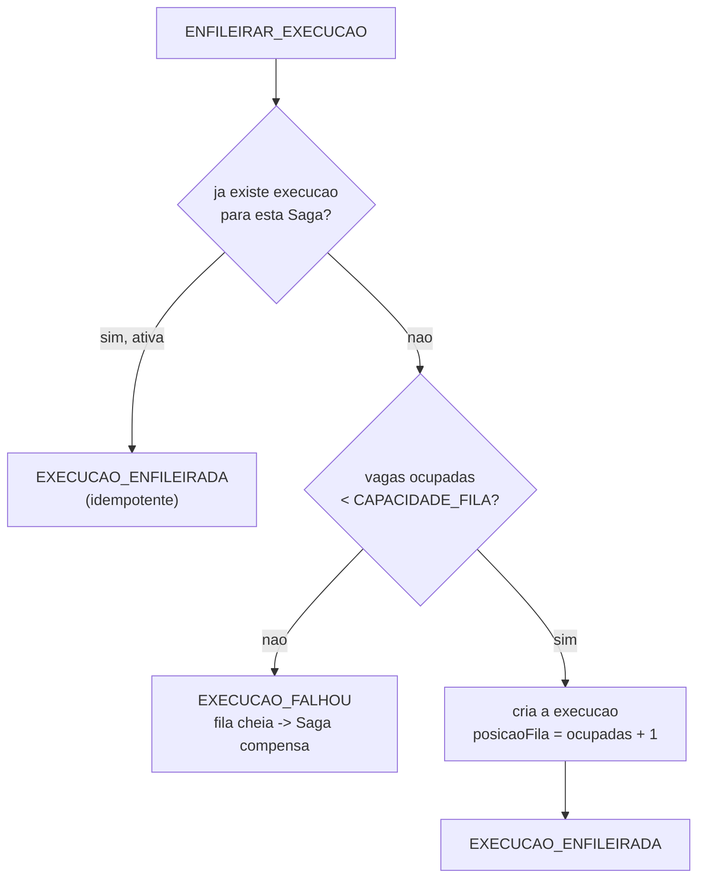

# Arquitetura do Execução Service

Documento específico deste participante. A visão do sistema distribuído, os
diagramas da Saga e os ADRs da Fase 4 estão no repositório do orquestrador:

- [Arquitetura geral da Fase 4](https://github.com/pyGits/fiap-tc-ms-os/blob/main/docs/arquitetura.md)
- [ADR-014 — divisão em três microsserviços](https://github.com/pyGits/fiap-tc-ms-os/blob/main/docs/adr/ADR-014-divisao-em-tres-microsservicos.md)
- [ADR-015 — Saga orquestrada](https://github.com/pyGits/fiap-tc-ms-os/blob/main/docs/adr/ADR-015-saga-orquestrada.md)
- [ADR-016 — RabbitMQ como broker](https://github.com/pyGits/fiap-tc-ms-os/blob/main/docs/adr/ADR-016-rabbitmq-como-broker.md)
- [ADR-017 — persistência poliglota](https://github.com/pyGits/fiap-tc-ms-os/blob/main/docs/adr/ADR-017-persistencia-poliglota.md)
- [ADR-018 — idempotência e dead letter](https://github.com/pyGits/fiap-tc-ms-os/blob/main/docs/adr/ADR-018-idempotencia-e-dead-letter.md)

---

## O par de comandos deste participante

Duas entradas, dois tempos distintos:

- **Fila** — o passo 5 da Saga, que dura milissegundos: aceitar o serviço e
  colocá-lo na fila.
- **REST** — o trabalho do mecânico, que dura horas ou dias, **depois** de a
  Saga terminar. Nenhuma transação distribuída pode esperar por um reparo.

A finalização publica um **evento**, não uma resposta: o OS Service reage ao
fato sem que este serviço o conheça (trecho coreografado).

## Respostas possíveis

| Comando | Sucesso | Falha |
| --- | --- | --- |
| `ENFILEIRAR_EXECUCAO` | `EXECUCAO_ENFILEIRADA` | `EXECUCAO_FALHOU` (fila cheia, itens inválidos, falha simulada) |
| `CANCELAR_EXECUCAO` | `EXECUCAO_CANCELADA` com `compensado: true` | `EXECUCAO_CANCELADA` com `compensado: false` (reparo já concluído) |

A compensação **nunca** responde falha: ela sempre libera a Saga. Quando o
reparo já está concluído e não há o que desfazer, o `compensado: false` registra
a pendência para tratamento manual, com evento próprio na telemetria.

## Ciclo de vida da execução

## Capacidade da oficina

Apenas `NA_FILA` e `EM_ANDAMENTO` ocupam vaga: execução cancelada ou finalizada
devolve a capacidade. Fila cheia é recusa **legítima de negócio** — e é o que dá
à Saga um caminho de falha realista no último passo.
